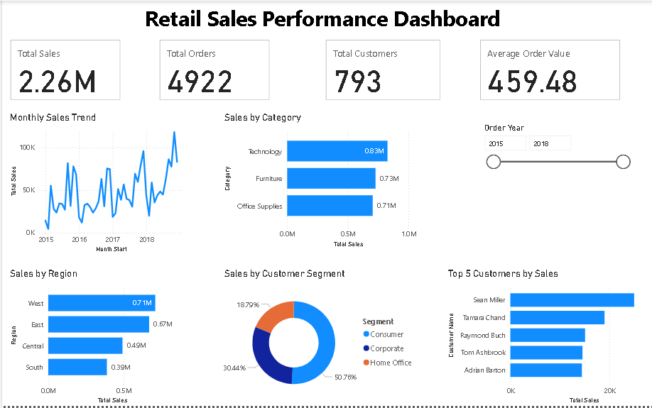

# Retail Sales Analysis

An end-to-end portfolio project using **Python, SQLite SQL, and Power BI** to clean retail sales data, explore business performance, and present findings through an interactive dashboard.

## Dashboard preview

## Project objective

Understand how recorded sales vary over time, across products, regions, and customer segments, and identify areas for further business investigation.

The supplied data covers **2015–2018**, with **9,800 sales line items** and **18 original columns**. Each row represents a product line within an order; orders can appear in multiple rows.

## Key metrics

| Metric | Full-period result |
|---|---:|
| Total sales | 2,261,536.78 |
| Unique orders | 4,922 |
| Unique customers | 793 |
| Average order value | 459.48 |

Average order value = total sales / distinct orders. Currency is not explicitly specified in the source file.

## Workflow

1. **Data understanding:** inspect columns, data types, missing values, and row granularity.
2. **Python cleaning:** trim text, parse dates, preserve postal codes as text, and validate sales and duplicates. Retain 11 missing postal codes without guessing replacements.
3. **Exploratory analysis:** examine annual and monthly trends, categories, regions, segments, leading customers, and time to shipment.
4. **SQL analysis:** use SQLite aggregations, distinct counts, subqueries, CTEs, and the LAG window function; compare totals with Python.
5. **Power BI reporting:** create DAX measures, KPI cards, a monthly sales trend, category and region charts, segment shares, a top-five customer ranking, and a year slicer.
6. **Business interpretation:** document findings, recommendations, and limitations.

## Findings and recommendations

| Finding | Recommended next step |
|---|---|
| Technology leads category sales at approximately 0.83 million. | Review leading products and stock availability; assess margins before increasing promotions. |
| West leads regional sales at approximately 0.71 million. | Investigate its product and customer mix and test relevant practices in other regions. |
| South has the lowest regional sales at approximately 0.39 million. | Compare customer counts, order frequency, and order value before selecting targeted initiatives. |
| Consumer contributes 50.76% of sales; Corporate contributes 30.44% and Home Office 18.79%. | Prioritise consumer service and test offers tailored to the other segments. |
| Sean Miller is the highest-sales customer across the full period. | Review recent purchasing activity and account needs before planning retention outreach. |

Category and regional amounts are rounded dashboard values. Findings describe the supplied records and do not establish causes.

## Repository files

| File | Purpose |
|---|---|
| [Retail_Sales_Analysis.ipynb](Retail_Sales_Analysis.ipynb) | Python cleaning, EDA, charts, and SQLite analysis notebook |
| [retail_sales_cleaned.csv](retail_sales_cleaned.csv) | Prepared dataset for analysis and reporting |
| [Retail_Sales_Dashboard.pbix](Retail_Sales_Dashboard.pbix) | Power BI report |
| [dashboard.png](dashboard.png) | Dashboard screenshot |
| [Retail_Sales_Final_Report.md](Retail_Sales_Final_Report.md) | Short report with findings and recommendations |

## How to explore the project

- Open the notebook on GitHub to review saved code and outputs, or open it in Google Colab to run it. The cleaning workflow starts with the original `train.csv`, which must be supplied separately; the cleaned CSV is included here.
- Download the `.pbix` file and open it in Power BI Desktop. If refreshing the data, update its CSV source path in Power Query to the downloaded cleaned dataset. Keep postal codes as Text and order and ship dates as Date.
- Adjust the year slicer to explore performance for a selected period. Restore 2015–2018 to reproduce the full-period metrics above.

## Tools and skills

**Python:** Pandas, Matplotlib, Seaborn  
**SQL:** SQLite, aggregations, CTEs, window functions  
**Power BI:** Power Query, DAX, data visualisation, interactive filtering

## Limitations and data provenance

The source was supplied as `train.csv`. Its original publisher and licence have not yet been documented in this repository; no third-party data ownership or redistribution rights are claimed.

The dataset has no profit, cost, quantity, discount, promised shipment date, or delivery date. Sales performance cannot establish profitability. Shipping Days measures order-to-shipment time, not customer delivery time or lateness. Completeness of the supplied records is not independently established.

## Author

**Mushtaq Noor** — BS Data Science graduate, UET Peshawar  
[GitHub](https://github.com/Mushtaq-noor) · [LinkedIn](https://www.linkedin.com/in/mushtaq-noor-49328a27a/)
